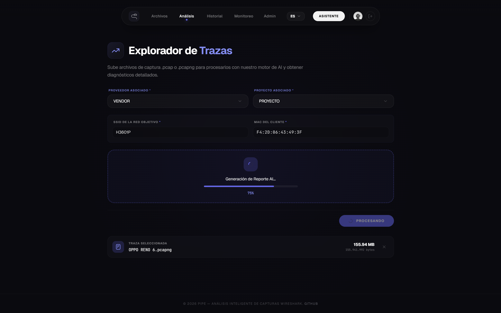
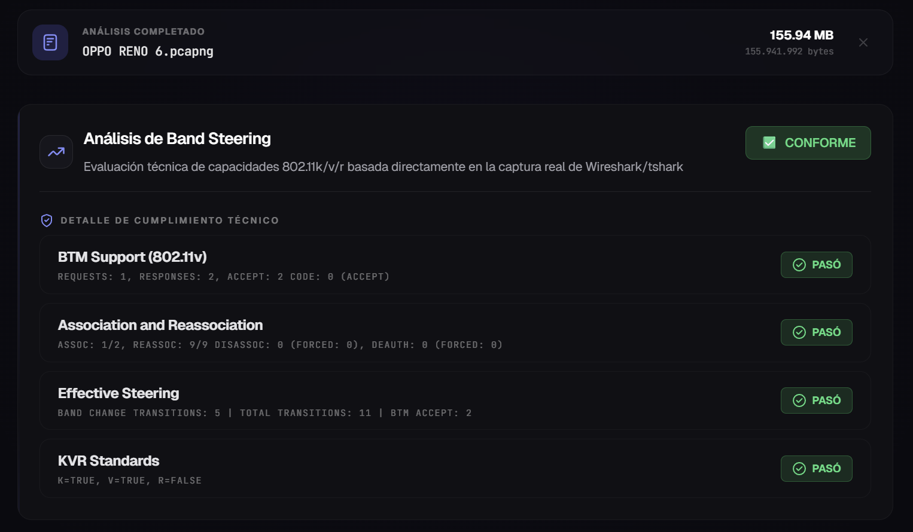
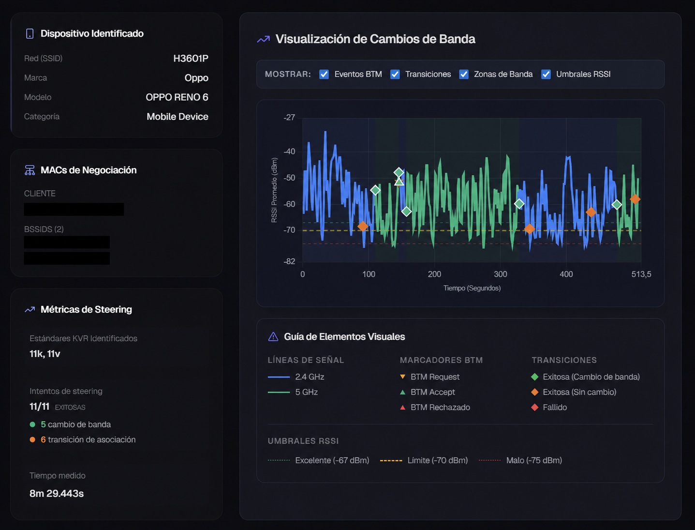
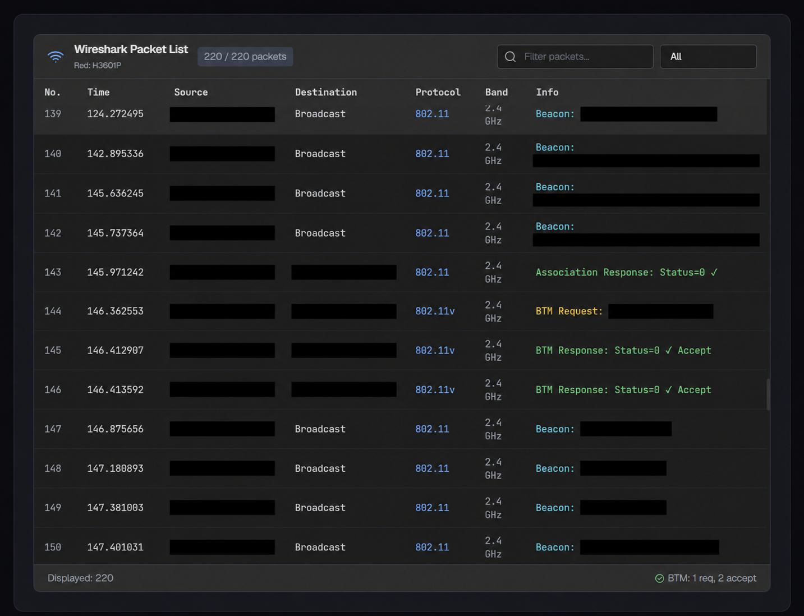
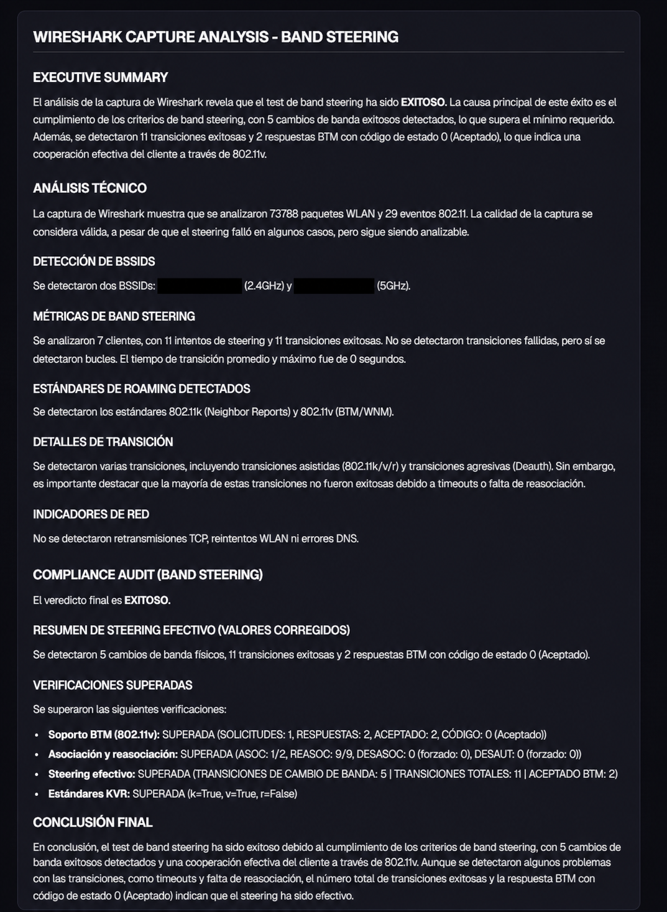
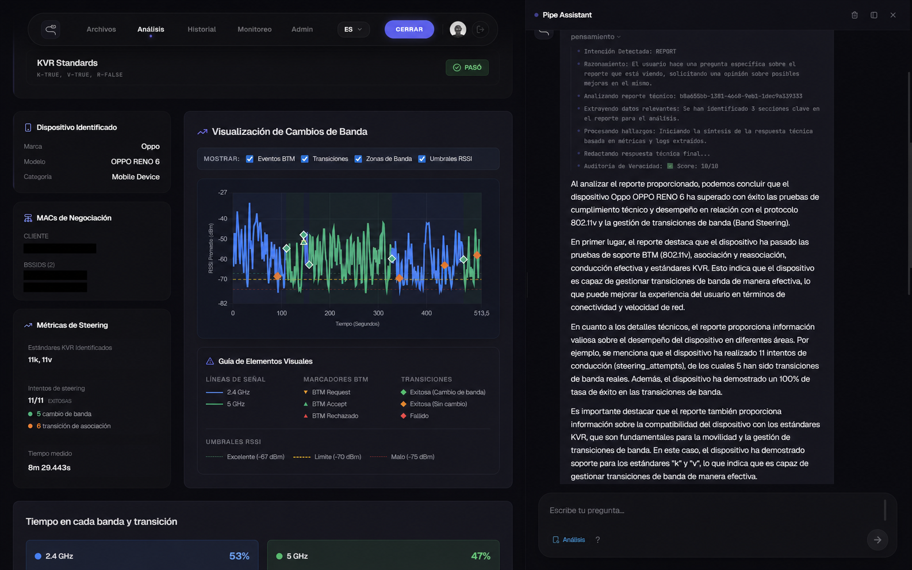
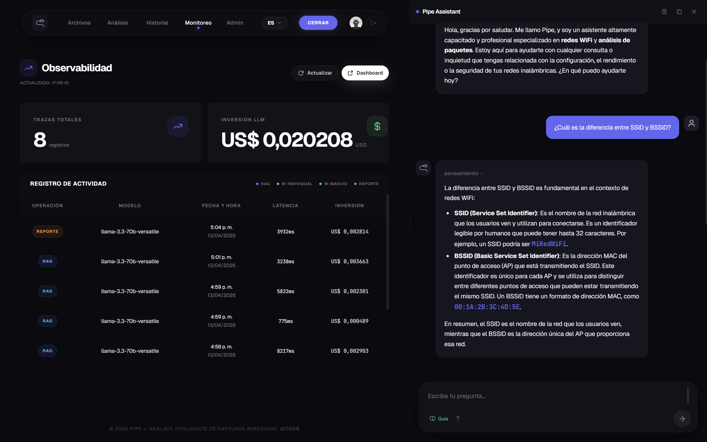
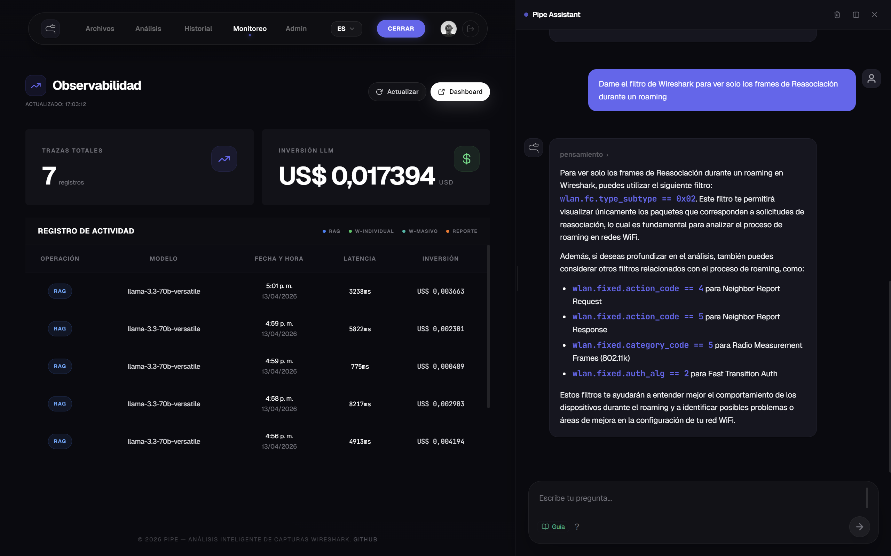

<div align="center">

# WiFi Expert Agent

**Analizador de redes Wi-Fi multiagente y multimodal que convierte capturas de paquetes de Wireshark en diagnósticos precisos hechos con IA.**

> 🔒 **Aviso de confidencialidad y propiedad intelectual:**
> El código fuente de este proyecto es privado y pertenece a **Tigo Colombia**. Este repositorio sirve solo como **muestra de arquitectura técnica** para mostrar el funcionamiento del sistema, los patrones de observabilidad y el diseño de ingeniería.

</div>

[English](README.md) · **Español**

---

## ¿Qué hace WiFi Expert Agent?

El agente experto en WiFi recibe archivos de captura de red (`.pcap` / `.pcapng`) generados con **Wireshark** y los procesa con un sistema de agentes de IA especializados que evalúa el comportamiento de los protocolos 802.11k/v/r (Band Steering / WiFi Roaming):

- ✅ **Análisis automático de Band Steering**: evalúa soporte BTM, asociación, steering efectivo y estándares KVR
- ✅ **Diagnósticos inteligentes**: Groq (Llama 3.3), Gemini 2.0 Flash y GPT-4o con enrutamiento dinámico según costo y calidad
- ✅ **Generación de reportes en PDF**: listos para entregar, con gráficas de señal, eventos BTM y conclusiones técnicas
- ✅ **Chat contextual**: el asistente Pipe responde preguntas sobre el análisis activo o sobre la documentación técnica de WiFi
- ✅ **Análisis por lotes**: procesa decenas de capturas en paralelo y permite descargar los resultados en un ZIP o en un PDF ejecutivo
- ✅ **Observabilidad en tiempo real**: registra costo, latencia y trazas del LLM por modelo y por operación

---

## 🖼️ Capturas de pantalla

### 1. Trace Explorer: carga y procesamiento

> El usuario sube un archivo `.pcapng` y selecciona el fabricante, el proyecto y la dirección MAC del cliente. El sistema procesa la captura con **tshark** y genera el análisis con IA.

<div align="center">

</div>

---

### 2. Resultado del análisis: Band Steering

> Resultado inmediato del análisis: veredicto de cumplimiento técnico por criterio (soporte BTM, asociación, steering efectivo, estándares KVR).

<div align="center">

</div>

---

### 3. Visualización de cambios de banda

> Gráfica interactiva de la señal RSSI en el tiempo, con marcadores de eventos BTM, transiciones de banda (2.4 GHz / 5 GHz) y umbrales configurables.

<div align="center">

</div>

---

### 4. Wireshark Packet List: vista de paquetes

> Panel integrado que muestra los paquetes 802.11 extraídos de la captura: origen, destino, protocolo, banda y descripción de la trama.

<div align="center">

</div>

---

### 5. Reporte PDF generado

> Reporte técnico generado automáticamente: resumen ejecutivo, análisis técnico, métricas de steering, detección de BSSID, estándares KVR y conclusión final.

<div align="center">

</div>

---

### 6. Modo reporte: el asistente analiza el reporte activo

> El **ReportAgent** accede directamente al análisis que está en pantalla. El usuario pregunta sobre el reporte actual y el agente extrae métricas, eventos BTM y conclusiones del análisis sin salir de la vista.

<div align="center">

</div>

---

### 7. Modo RAG: chat con la documentación técnica de WiFi

> El **RAGAgent** responde con la base de conocimiento interna. Busca en Qdrant los fragmentos de documentación técnica más relevantes y los usa como contexto para generar una respuesta fundamentada. A la izquierda, el Observability Dashboard muestra en tiempo real las trazas de Langfuse de cada llamada al LLM: operación, modelo usado, latencia y costo en USD por llamada.

<div align="center">

</div>

---

### 8. Modo RAG: respuesta con filtros de Wireshark

> Otra consulta en modo RAG: el usuario pide filtros de Wireshark para analizar tramas de reasociación durante un evento de roaming. El agente muestra su cadena de razonamiento antes de entregar la respuesta técnica con los filtros exactos.

<div align="center">

</div>

---

## ⚙️ Cómo funciona por dentro

### Procesamiento de una captura PCAP

Cuando el usuario sube un archivo `.pcap` o `.pcapng`, el backend ejecuta este pipeline:

```
PCAP
  │
  ├─ 1. WiresharkTool (tshark) — extracts 802.11 frames
  │      ├─ Beacon frames (AP info, SSID, channel, band)
  │      ├─ BTM Request / Response (Band Steering)
  │      ├─ Probe Request / Response
  │      ├─ Association / Reassociation
  │      └─ Deauthentication
  │
  ├─ 2. BTMAnalyzer — computes Band Steering metrics
  │      ├─ Band transition latency
  │      ├─ BTM acceptance rate
  │      ├─ Time distribution across 2.4 GHz vs 5 GHz
  │      ├─ Sticky client and slow roaming detection
  │      └─ KVR verification (802.11k / 802.11v / 802.11r)
  │
  ├─ 3. LLM Analysis — generates technical insights
  │      ├─ Evaluates 802.11k/v/r compliance
  │      ├─ Identifies issues and anomalies
  │      └─ Produces improvement recommendations
  │
  └─ 4. Persistence across 3 databases in parallel
         ├─ PostgreSQL — structured analysis + metadata
         ├─ Qdrant     — embeddings for future semantic search
         └─ FalkorDB   — topology graph (Client → AP, transitions)
```

### Sistema multiagente

El núcleo de la IA es un **AgentDispatcher** que clasifica cada consulta antes de procesarla. El flujo es:

```
User query
  │
  ├─ SecurityTool       — validates against malicious injection
  ├─ IntentClassifier   — detects intent (simple / rag / report / graph)
  │
  └─ Routing to the specialized agent:
       ├─ SimpleAgent   → direct LLM call, no context (response < 2s)
       ├─ RAGAgent      → searches Qdrant, uses top-5 documents as context
       ├─ ReportAgent   → accesses the active analysis (PostgreSQL + embeddings)
       └─ GraphAgent    → queries the network topology in FalkorDB (Cypher)
```

Cada agente tiene su propio system prompt y su propio conjunto de Skills, expuestas como herramientas a través de una capa propia de **Model Context Protocol (MCP)**, lo que reduce las alucinaciones y optimiza el uso de tokens. Antes de devolver una respuesta, un **Judge System** valida y califica las salidas de los agentes según su precisión y pertinencia, y descarta las respuestas de baja calidad.

### Enrutamiento de modelos LLM

El sistema no depende de un solo modelo: elige el proveedor de forma dinámica según la tarea:

| Nivel      | Modelo               | Caso de uso                            |
| ---------- | --------------------- | -------------------------------------- |
| `routing`  | Groq · Llama-3.3-70b | Clasificación de intención             |
| `cheap`    | Groq · Llama-3.3-70b | Conversación general                   |
| `standard` | Gemini 2.0 Flash     | Análisis de capturas                   |
| `quality`  | GPT-4o               | Análisis complejos de alta precisión   |
| `fallback` | GPT-4o-mini          | Si falla el proveedor principal        |

Si un proveedor falla, el sistema pasa automáticamente al siguiente sin interrumpir el flujo.

### Streaming de respuestas (SSE)

El chat usa **Server-Sent Events** para transmitir la respuesta token por token. El frontend recibe distintos tipos de eventos:

```
data: {"type": "status",  "content": "Classifying intent..."}
data: {"type": "thought", "content": "Detected intent: RAG"}
data: {"type": "thought", "content": "Searching vector database..."}
data: {"type": "token",   "content": "Band "}
data: {"type": "token",   "content": "Steering "}
data: {"type": "done",    "content": ""}
```

Así se puede mostrar en tiempo real el razonamiento interno del agente antes de que aparezca la respuesta final.

### Análisis por lotes

Para proyectos grandes, Pipe ofrece procesamiento en paralelo:

1. El usuario sube varios archivos `.pcap` a la vez junto con sus metadatos (SSID, MAC, proyecto)
2. Cada archivo entra a una cola en **Redis**
3. Un `QueueWorker` en segundo plano procesa las tareas en paralelo
4. El usuario sigue el progreso en tiempo real (`processed / total`)
5. Al terminar, el usuario puede descargar:
    - **ZIP completo**: capturas originales + PDF individuales + resumen
    - **ZIP de reportes**: solo los PDF
    - **PDF ejecutivo**: diagnóstico consolidado de toda la sesión

### Base de datos de grafos (FalkorDB)

Cada análisis alimenta un grafo de topología de red con esta estructura:

```
Nodes:
  - Client  { mac, ip, vendor }
  - AP      { bssid, ssid, channel, band }
  - Vendor  { vendor_id, name }
  - Project { project_id, name }

Relations:
  - (Client)-[CONNECTED_TO { timestamp, signal_dBm }]→(AP)
  - (Client)-[TRANSITIONED_TO { from_band, to_band, latency_ms }]→(AP)
  - (AP)-[BELONGS_TO]→(Project)
  - (Project)-[MANAGED_BY]→(Vendor)
```

El `GraphAgent` puede consultar esta topología con preguntas como:

> _"¿Qué clientes han hecho la transición al AP con BSSID d4:ab:82:39:44:e1?"_

### Seguridad y control de acceso

La autenticación la maneja **Keycloak** con tres roles:

| Rol       | Permisos                                                                   |
| --------- | -------------------------------------------------------------------------- |
| `viewer` | Acceso de solo lectura a reportes y análisis                                |
| `editor` | Subir capturas, generar análisis, exportar PDF                              |
| `admin`  | Todo lo anterior + gestión de usuarios, fabricantes, proyectos y observabilidad |

Toda petición al backend pasa primero por **KrakenD** (API Gateway), que valida el JWT con Keycloak y reenvía al backend los headers `X-User-Id`, `X-User-Name` y `X-Roles`.

---

## 🏗️ Stack tecnológico

| Capa           | Tecnologías                                                                 |
| -------------- | --------------------------------------------------------------------------- |
| **Frontend**       | React 18, Vite, TailwindCSS                                              |
| **Backend**        | FastAPI, Python 3.12, Uvicorn                                            |
| **IA / Agentes**   | LiteLLM, LangChain, MCP (propio), Groq (Llama 3.3), Gemini 2.0, GPT-4o  |
| **Análisis WiFi**  | tshark / Wireshark, PyShark                                              |
| **Bases de datos** | PostgreSQL, Qdrant (vectorial), FalkorDB (grafos), Redis                 |
| **Auth**           | Keycloak (JWT, roles: admin / editor / viewer)                          |
| **Gateway**        | KrakenD                                                                  |
| **Observabilidad** | Langfuse                                                                 |
| **Infra**          | Docker Compose, Nginx, AWS                                               |

---

## ⚙️ Vista general de la arquitectura

```
Browser (React)
    │
    ▼
KrakenD (API Gateway + JWT validation)
    │
    ▼
FastAPI Backend
    ├─ AgentDispatcher → SecurityTool → IntentClassifier
    │       ├─ SimpleAgent   (general conversation)
    │       ├─ RAGAgent      (Qdrant + technical documentation)
    │       ├─ ReportAgent   (analysis over existing reports)
    │       └─ GraphAgent    (network topology in FalkorDB)
    │
    ├─ BandSteeringService → tshark → BTMAnalyzer → LLM → PDF
    └─ MassiveAnalysisQueue (Redis + background workers)
         │
    ┌────┴───────────────────────────────────────┐
    │  PostgreSQL · Qdrant · Redis · FalkorDB    │
    └────────────────────────────────────────────┘
              ↕ Langfuse (traces + costs + latencies)
```

---

<div align="center">
<p>Desarrollado por <a href="https://github.com/miguelczz"><b>miguelczz</b></a> · 2026</p>
</div>
