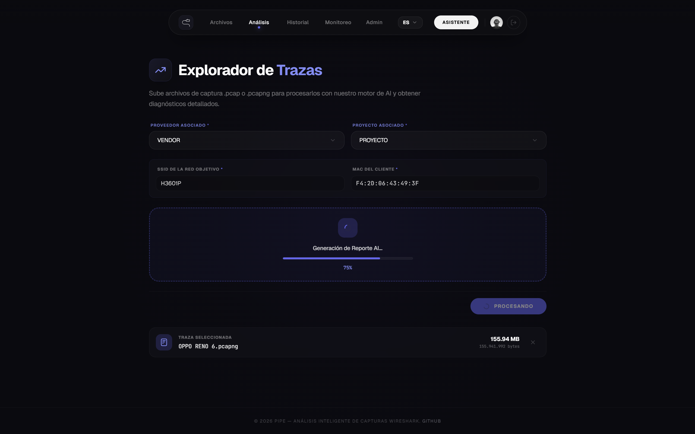
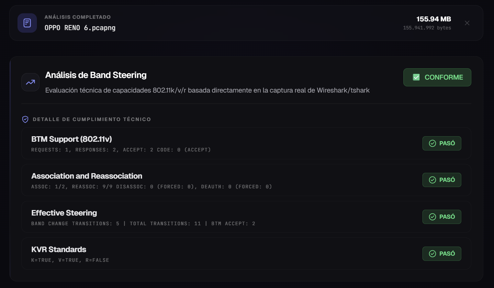
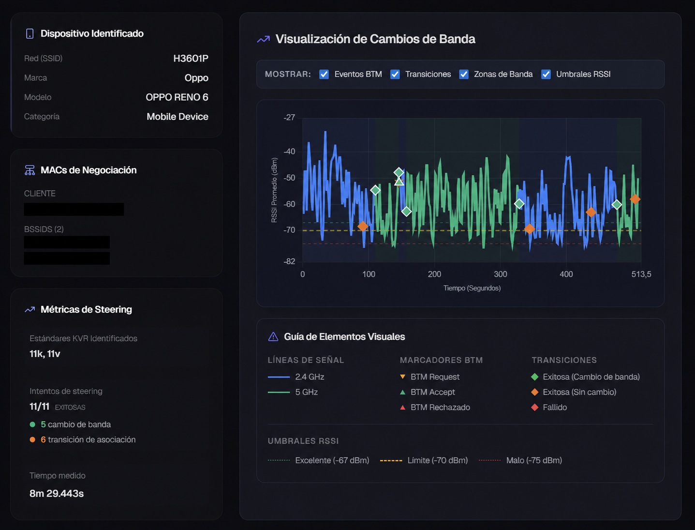
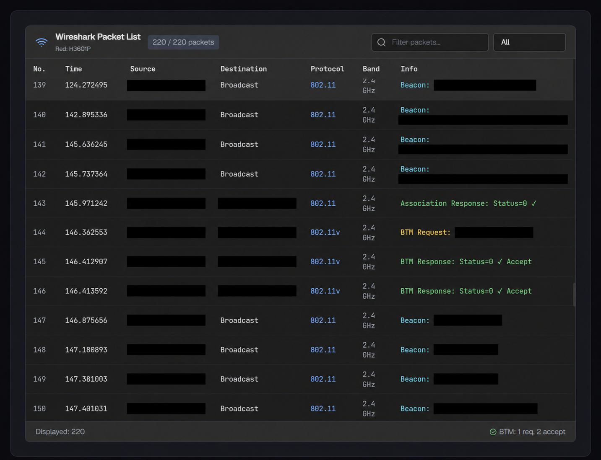
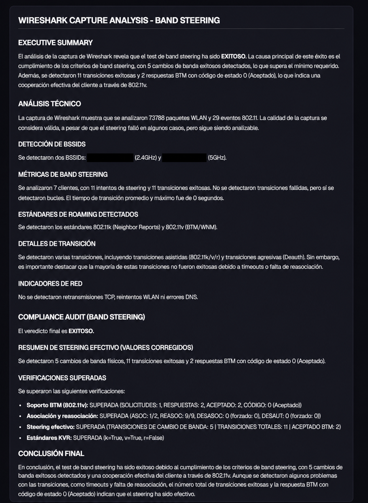
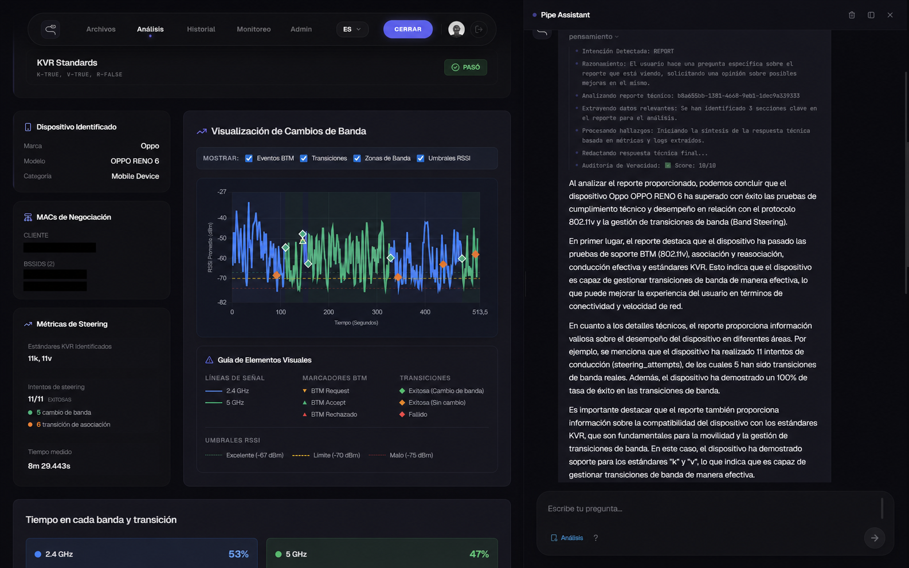
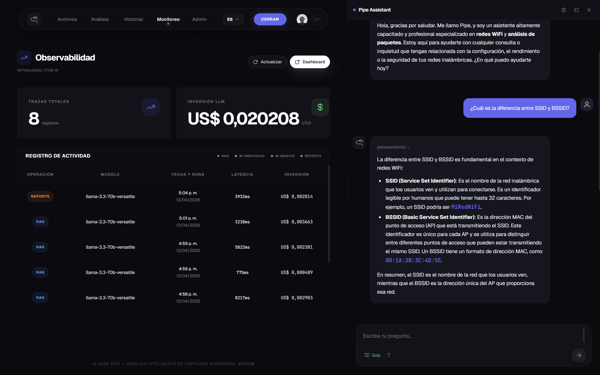
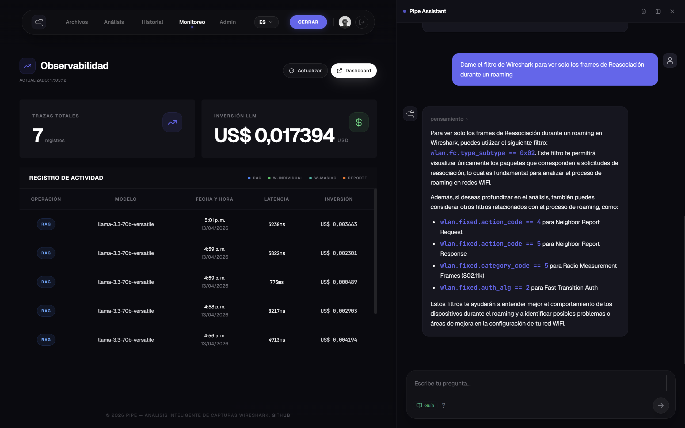

<div align="center">

# Agente Experto WiFi

**Analizador multi-agente y multimodal de redes Wi-Fi que transforma capturas de Wireshark en diagnósticos precisos mediante IA.**

> 🔒 **Nota de Confidencialidad & Propiedad Intelectual:**
> El código fuente de este proyecto es de carácter privado y propiedad de **Tigo Colombia**. Este repositorio sirve únicamente como **Demostración Técnica de Arquitectura** para dar a conocer la funcionalidad, patrones de observabilidad e ingeniería del sistema.

</div>

---

## ¿Qué hace el Agente Experto en Wifi?

Pipe recibe archivos de captura de red (`.pcap` / `.pcapng`) generados con **Wireshark** y los procesa mediante un sistema de agentes IA especializado que evalúa el comportamiento del protocolo 802.11k/v/r (Band Steering / Roaming WiFi):

- ✅ **Análisis automático de Band Steering** — evalúa BTM Support, Association, Effective Steering y KVR Standards
- ✅ **Diagnóstico inteligente** — Groq (Llama 3.3), Gemini 2.0 Flash y GPT-4o con routing dinámico por costo y calidad
- ✅ **Generación de reportes PDF** — listos para entregar, con gráficas de señal, eventos BTM y conclusiones técnicas
- ✅ **Chat contextual** — el asistente Pipe responde preguntas sobre el análisis activo o sobre documentación técnica WiFi
- ✅ **Análisis masivo** — procesa decenas de capturas en paralelo y permite descargar resultados como ZIP o PDF ejecutivo
- ✅ **Observabilidad en tiempo real** — tracking de costos, latencias y trazas LLM por modelo y operación

---

## 🖼️ Capturas de Pantalla

### 1. Explorador de Trazas — Subida y procesamiento

> El usuario sube un `.pcapng`, selecciona el vendor, proyecto y MAC del cliente. El sistema procesa la captura con **tshark** y genera el análisis con IA.

<div align="center">

</div>

---

### 2. Resultado de Análisis — Band Steering

> Resultado inmediato del análisis: veredicto de cumplimiento técnico por criterio (BTM Support, Association, Effective Steering, KVR Standards).

<div align="center">

</div>

---

### 3. Visualización de Cambios de Banda

> Gráfica interactiva de señal RSSI en el tiempo, con marcadores de eventos BTM, transiciones de banda (2.4 GHz / 5 GHz) y umbrales configurables.

<div align="center">

</div>

---

### 4. Wireshark Packet List — Vista de paquetes

> Panel integrado que muestra los paquetes 802.11 extraídos de la captura: origen, destino, protocolo, banda y descripción del frame.

<div align="center">

</div>

---

### 5. Reporte PDF Generado

> Reporte técnico generado automáticamente: executive summary, análisis técnico, métricas de steering, detección de BSSIDs, estándares KVR y conclusión final.

<div align="center">

</div>

---

### 6. Modo Reporte — Asistente analizando el reporte activo

> El **ReportAgent** accede directamente al análisis en pantalla. El usuario pregunta sobre el reporte actual y el agente extrae métricas, eventos BTM y conclusiones del análisis sin salir de la vista.

<div align="center">

</div>

---

### 7. Modo RAG — Chat con documentación técnica WiFi

> El **RAGAgent** responde usando la base de conocimiento interna. Busca en Qdrant los chunks más relevantes de la documentación técnica y los usa como contexto para generar una respuesta fundada. A la izquierda se muestra el **Dashboard de Observabilidad**, que extrae en tiempo real desde **Langfuse** las trazas de cada llamada LLM: operación, modelo utilizado, latencia e inversión en USD por llamada.

<div align="center">

</div>

---

### 8. Modo RAG — Respuesta con filtros Wireshark

> Otra consulta en **Modo RAG**: el usuario pide filtros de Wireshark para analizar frames de reasociación durante un roaming. El agente muestra su cadena de pensamiento antes de entregar la respuesta técnica con los filtros exactos.

<div align="center">

</div>

---

## ⚙️ Cómo funciona — Bajo el capó

### Procesamiento de una captura PCAP

Cuando el usuario sube un archivo `.pcap` o `.pcapng`, el backend ejecuta este pipeline:

```
PCAP
  │
  ├─ 1. WiresharkTool (tshark) — extrae frames 802.11
  │      ├─ Beacon frames (info del AP, SSID, channel, band)
  │      ├─ BTM Request / Response (Band Steering)
  │      ├─ Probe Request / Response
  │      ├─ Association / Reassociation
  │      └─ Deauthentication
  │
  ├─ 2. BTMAnalyzer — calcula métricas de Band Steering
  │      ├─ Latencia de transiciones entre bandas
  │      ├─ Tasa de aceptación de BTM (acceptance rate)
  │      ├─ Distribución de tiempo en 2.4 GHz vs 5 GHz
  │      ├─ Detección de sticky clients y roaming lento
  │      └─ Verificación KVR (802.11k / 802.11v / 802.11r)
  │
  ├─ 3. LLM Analysis — genera insights técnicos
  │      ├─ Evalúa cumplimiento de 802.11k/v/r
  │      ├─ Identifica problemas y anomalías
  │      └─ Produce recomendaciones de mejora
  │
  └─ 4. Persistencia en 3 bases de datos en paralelo
         ├─ PostgreSQL — análisis estructurado + metadata
         ├─ Qdrant     — embeddings para búsqueda semántica futura
         └─ FalkorDB   — grafo de topología (Cliente → AP, transiciones)
```

### Sistema Multi-Agente

El núcleo de la IA es un **AgentDispatcher** que clasifica cada consulta antes de procesarla. El flujo es:

```
Consulta del usuario
  │
  ├─ SecurityTool       — valida que no haya inyección maliciosa
  ├─ IntentClassifier   — detecta la intención (simple / rag / report / graph)
  │
  └─ Routing al agente especializado:
       ├─ SimpleAgent   → LLM directo, sin contexto (respuesta < 2s)
       ├─ RAGAgent      → busca en Qdrant, usa top-5 documentos como contexto
       ├─ ReportAgent   → accede al análisis activo (PostgreSQL + embeddings)
       └─ GraphAgent    → consulta la topología de red en FalkorDB (Cypher)
```

Cada agente tiene su propio system prompt y conjunto de Skills, lo que reduce alucinaciones y optimiza el consumo de tokens.

### Routing de Modelos LLM

El sistema no usa un único modelo: selecciona dinámicamente el proveedor según la tarea:

| Tier       | Modelo               | Uso                                  |
| ---------- | -------------------- | ------------------------------------ |
| `routing`  | Groq · Llama-3.3-70b | Clasificación de intenciones         |
| `cheap`    | Groq · Llama-3.3-70b | Conversación general                 |
| `standard` | Gemini 2.0 Flash     | Análisis de capturas                 |
| `quality`  | GPT-4o               | Análisis complejos de alta precisión |
| `fallback` | GPT-4o-mini          | Si el proveedor principal falla      |

Si un proveedor falla, el sistema conmuta automáticamente al siguiente sin interrumpir el flujo.

### Streaming de respuestas (SSE)

El chat usa **Server-Sent Events** para transmitir la respuesta token a token. El frontend recibe eventos de distintos tipos:

```
data: {"type": "status",  "content": "Clasificando intención..."}
data: {"type": "thought", "content": "Intención detectada: RAG"}
data: {"type": "thought", "content": "Buscando en base de datos vectorial..."}
data: {"type": "token",   "content": "Band "}
data: {"type": "token",   "content": "Steering "}
data: {"type": "done",    "content": ""}
```

Esto permite mostrar el razonamiento interno del agente en tiempo real, antes de que aparezca la respuesta final.

### Análisis Masivo

Para proyectos grandes Pipe ofrece procesamiento en paralelo:

1. El usuario sube múltiples `.pcap` de una vez con sus metadatos (SSID, MAC, proyecto)
2. Cada archivo se encola en **Redis**
3. Un `QueueWorker` en background procesa las tareas en paralelo
4. El usuario monitorea el progreso en tiempo real (`procesados / total`)
5. Al finalizar puede descargar:
    - **ZIP completo** — capturas originales + PDFs individuales + resumen
    - **ZIP de reportes** — solo los PDFs
    - **PDF ejecutivo** — diagnóstico consolidado de toda la sesión

### Base de Datos de Grafos (FalkorDB)

Cada análisis alimenta un grafo de topología de red con la siguiente estructura:

```
Nodes:
  - Client  { mac, ip, vendor }
  - AP      { bssid, ssid, channel, band }
  - Vendor  { vendor_id, name }
  - Project { project_id, name }

Relations:
  - (Client)-[CONNECTED_TO { timestamp, signal_dBm }]→(AP)
  - (Client)-[TRANSITIONED_TO { from_band, to_band, latency_ms }]→(AP)
  - (AP)-[BELONGS_TO]→(Project)
  - (Project)-[MANAGED_BY]→(Vendor)
```

El `GraphAgent` puede consultar esta topología con preguntas como:

> _"¿Qué clientes han transitado al AP con BSSID d4:ab:82:39:44:e1?"_

### Seguridad y Control de Acceso

La autenticación la gestiona **Keycloak** con tres roles:

| Rol      | Permisos                                                                    |
| -------- | --------------------------------------------------------------------------- |
| `viewer` | Solo lectura de reportes y análisis                                         |
| `editor` | Subir capturas, generar análisis, exportar PDFs                             |
| `admin`  | Todo lo anterior + gestión de usuarios, vendors, proyectos y observabilidad |

Cada petición al backend pasa primero por **KrakenD** (API Gateway), que valida el JWT con Keycloak y propaga al backend los headers `X-User-Id`, `X-User-Name` y `X-Roles`.

---

## 🏗️ Stack Tecnológico

| Capa               | Tecnologías                                              |
| ------------------ | -------------------------------------------------------- |
| **Frontend**       | React 18, Vite, TailwindCSS                              |
| **Backend**        | FastAPI, Python 3.12, Uvicorn                            |
| **IA / Agentes**   | LiteLLM, LangChain, Groq (Llama 3.3), Gemini 2.0, GPT-4o |
| **Análisis WiFi**  | tshark / Wireshark, PyShark                              |
| **Bases de datos** | PostgreSQL, Qdrant (vectorial), FalkorDB (grafos), Redis |
| **Auth**           | Keycloak (JWT, roles: admin / editor / viewer)           |
| **Gateway**        | KrakenD                                                  |
| **Observabilidad** | Langfuse                                                 |
| **Infra**          | Docker Compose, Nginx, AWS                               |

---

## ⚙️ Arquitectura resumida

```
Browser (React)
    │
    ▼
KrakenD (API Gateway + JWT validation)
    │
    ▼
FastAPI Backend
    ├─ AgentDispatcher → SecurityTool → IntentClassifier
    │       ├─ SimpleAgent   (conversación general)
    │       ├─ RAGAgent      (Qdrant + documentación técnica)
    │       ├─ ReportAgent   (análisis sobre reportes existentes)
    │       └─ GraphAgent    (topología de red en FalkorDB)
    │
    ├─ BandSteeringService → tshark → BTMAnalyzer → LLM → PDF
    └─ MassiveAnalysisQueue (Redis + background workers)
         │
    ┌────┴───────────────────────────────────────┐
    │  PostgreSQL · Qdrant · Redis · FalkorDB    │
    └────────────────────────────────────────────┘
              ↕ Langfuse (trazas + costos + latencias)
```

---

<div align="center">
<p>Desarrollado por <a href="https://github.com/miguelczz"><b>miguelczz</b></a> · 2026</p>
</div>
